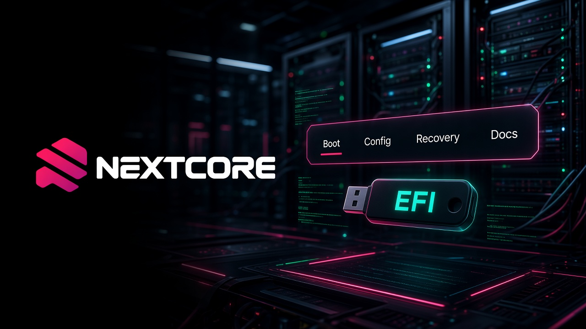
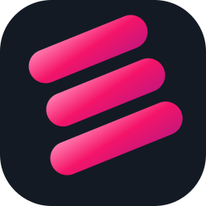
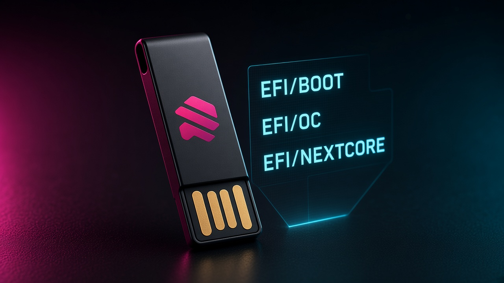
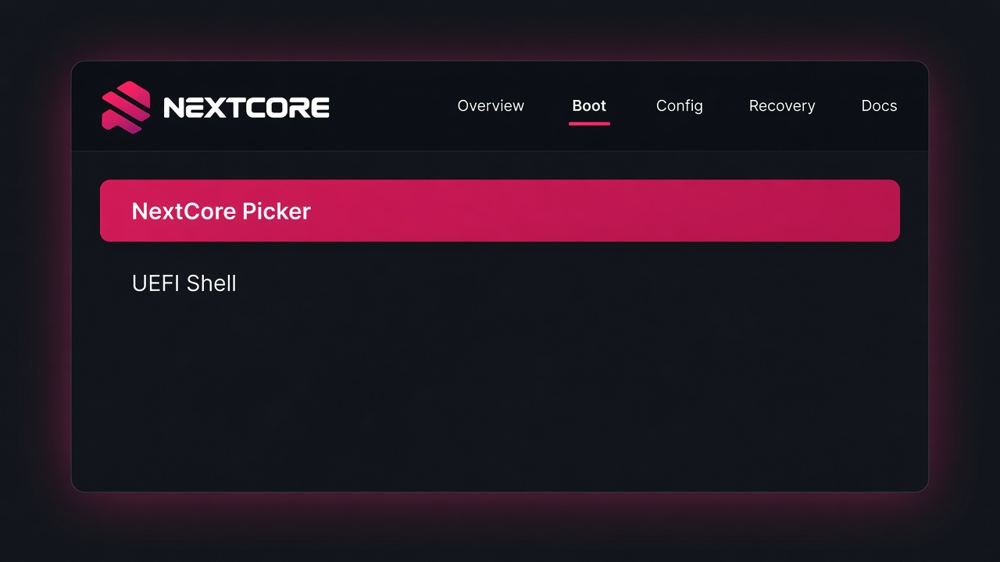
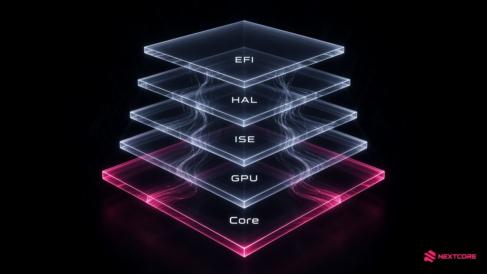
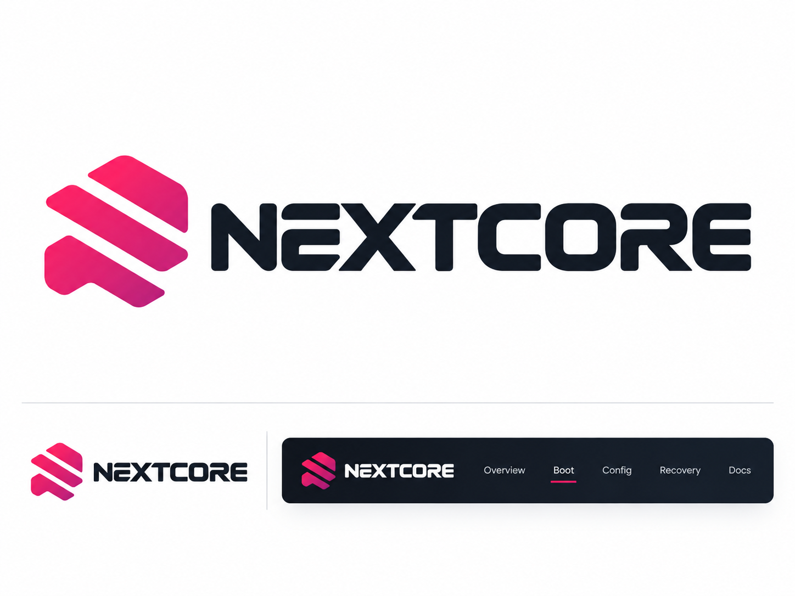

<div align="center">

<a href="https://26x86.github.io/">
  
</a>



# NEXTCORE

**Experimental UEFI tooling for macOS on x86**

Public USB creator · EFI folder generator · prebuilt picker binary

[Live site](https://26x86.github.io/) · [NextCore repo](https://github.com/26x86/NextCore) · [r/NextCore](https://www.reddit.com/r/NextCore/)

`macos_boot_verified = false`

</div>

<p align="center">
  <a href="https://github.com/26x86/NextCore"></a>
  <a href="https://github.com/26x86/NextCore"></a>
  <a href="https://github.com/26x86/NextCore/releases/tag/v1.0.0"></a>
</p>

---

## Why this org exists

26x86 builds **NextCore**: a clean-room UEFI boot component and the userland tools around it.
The [public NextCore repository](https://github.com/26x86/NextCore) is the consumer surface — a
hashed `BOOTX64.EFI`, `tools/make_efi.py`, and `tools/make-usb.ps1`. Crate source and research
stay in the private monorepo.

Reaching an OpenCore picker is firmware load. It is **not** a macOS boot.

<details>
<summary><strong>Start on a USB stick (Windows)</strong></summary>

```powershell
git clone https://github.com/26x86/NextCore.git
cd NextCore
python tools/make_efi.py --profile 15igl7 --out out/15igl7
# elevated PowerShell
.\tools\make-usb.ps1 -List
.\tools\make-usb.ps1 -Profile 15igl7 -DiskNumber <N> -Force
```

Replace SMBIOS serial / MLB / UUID before you boot. The Recovery picker entry stays disabled
until a real APFS Recovery volume exists.

</details>

<details>
<summary><strong>Honest limits</strong></summary>

- `macos_boot_verified` remains **false** until target-matching XNU and userspace evidence exist.
- A `BaseSystem.dmg` copied onto exFAT is a file dump, not Apple Recovery.
- The `15igl7` profile targets Intel Gemini Lake: no AVX2, no macOS 26 graphics driver.
- **2.0.0** is reserved for a UART-verified macOS 27 boot. Do not advertise it early.

</details>

## Map

| Surface | Repository | Role |
| --- | --- | --- |
| **Public consumer** | [NextCore](https://github.com/26x86/NextCore) | Picker binary + USB/EFI generators |
| Private source | [26x86](https://github.com/26x86/26x86) | Monorepo, research, `_isolated/` |
| UEFI | [Nextcore-EFI](https://github.com/26x86/Nextcore-EFI) | EFI application and handoff probes |
| Core / HAL / ISE | [Core](https://github.com/26x86/Nextcore-Core) · [HAL](https://github.com/26x86/Nextcore-HAL) · [ISE](https://github.com/26x86/Nextcore-ISE) | Config, tables, ARM64e runtime |
| GPU / APLS / Tool | [GPU](https://github.com/26x86/Nextcore-GPU) · [APLS](https://github.com/26x86/Nextcore-APLS) · [Tool](https://github.com/26x86/Nextcore-Tool) | Policy, recovery runner, CLI |
| Pointer | [Nextcore-Binaries](https://github.com/26x86/Nextcore-Binaries) | Superseded — use NextCore |

Interactive landing (cursor, tilt cards, live grid): **[26x86.github.io](https://26x86.github.io/)**

<div align="center">



Pink `#F41469` · Ink `#131A24` · Paper `#F6F7F9`

</div>
