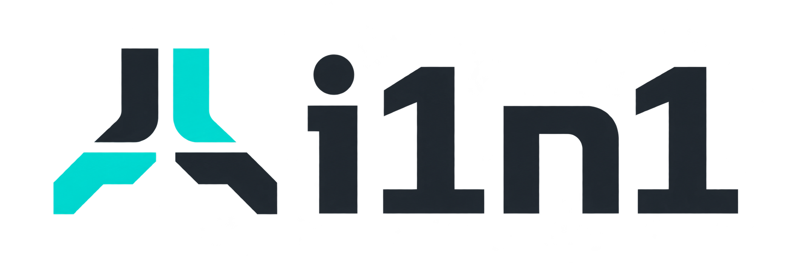

<picture>
  <source media="(prefers-color-scheme: dark)" srcset="assets/i1n1-logo-dark.png">
  
</picture>

**Apple ARM64e Bootstrap for x86-64 Apple Device**

i1n1 is an experimental bootstrap project. Its objective is to start from UEFI on an x86-64 Apple machine and execute ARM64/arm64e guest code through an owned software runtime. A second track builds and stages the pinned upstream [q1n1](https://github.com/Acelogic/q1n1) for native AArch64 UEFI.

The organization publishes **source only**: no releases, prereleases or compiled EFI images. Neither track boots macOS or Windows today, and no physical machine is qualified.

## Start here

| | |
| --- | --- |
| Source | [i1n1/i1n1](https://github.com/i1n1/i1n1) |
| Build and run | [howto.md](https://github.com/i1n1/i1n1/blob/main/howto.md) |
| Documentation | [Docs](https://github.com/i1n1/i1n1/blob/main/Docs/README.md) |
| Scope and evidence | [Compatibility](https://github.com/i1n1/i1n1/blob/main/Docs/Compatibility.md) |
| Organization and publication policy | [Organization](https://github.com/i1n1/i1n1/blob/main/Docs/Organization.md) |
| Upstream provenance | [References](https://github.com/i1n1/i1n1/blob/main/Docs/References.md), [ARM64 UEFI and q1n1](https://github.com/i1n1/i1n1/blob/main/Docs/Arm64UEFI.md) |

## What exists

- **Native components.** An ONXT wire codec, a bounded software A64 interpreter with stage-1 MMU, owned RAM and synthetic pointer authentication, and a q1n1 wire codec and monitor. Also timer, GIC, PCI and x86 models and a hosted CPU-buffer broker, all with authored tests.
- **UEFI codec demo.** Built for AArch64 (default) and x64; console PASS observed in QEMU.
- **q1n1 connector.** A pin-bound connector that validates, builds and stages upstream q1n1; its preflight was observed at EL2 in QEMU.

Project-authored material is GPL-2.0-only. Third-party projects keep their own licenses and are referenced, not bundled. Predecessor research and historical mirrors are private.

## Taking part

Report reproducible defects and documentation corrections through [issues](https://github.com/i1n1/i1n1/issues). Follow [Security](https://github.com/i1n1/i1n1/blob/main/SECURITY.md) for sensitive findings and [Contributing](https://github.com/i1n1/i1n1/blob/main/CONTRIBUTING.md) before submitting changes. Do not attach proprietary software, credentials or memory captures.
