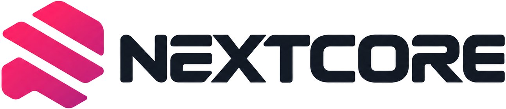

<div align="center">

<picture>
  <source media="(prefers-color-scheme: dark)" srcset="assets/lockup-white.png">
  
</picture>

</div>

**NextCore** is an experimental UEFI project for macOS boot paths on x86. It is not a finished operating-system port and not a supported installer.

- Site: [26x86.github.io](https://26x86.github.io/)
- Public tools: [github.com/26x86/NextCore](https://github.com/26x86/NextCore)
- Discussion: [r/NextCore](https://www.reddit.com/r/NextCore/)

`macos_boot_verified = false`

## Getting Started

```powershell
git clone https://github.com/26x86/NextCore.git
cd NextCore
python tools/make_efi.py --profile 15igl7 --out out/15igl7
# elevated PowerShell
.\tools\make-usb.ps1 -List
.\tools\make-usb.ps1 -Profile 15igl7 -DiskNumber <N> -Force
```

Replace `SystemSerialNumber`, `MLB`, `SystemUUID`, and `ROM` in `EFI/OC/config.plist` before use. The Recovery picker entry stays disabled until an APFS Recovery volume exists.

## Status

| Item | Value |
| --- | --- |
| x86 UEFI load | partial |
| OpenCore chain-load | staged |
| macOS Recovery volume | absent on exFAT |
| macos_boot_verified | false |

A `BaseSystem.dmg` copied onto exFAT is a file, not Apple Recovery. The `15igl7` profile records Intel Gemini Lake (no AVX2, no macOS 26 GPU driver). Version 1.0.0 is a packaging release. Version 2.0.0 is reserved until UART evidence shows target-matching XNU and userspace.

## Repositories

| Repository | Role |
| --- | --- |
| [NextCore](https://github.com/26x86/NextCore) | Picker binary, EFI generator, USB writer |
| [26x86](https://github.com/26x86/26x86) | Private monorepo (source, research) |
| [Nextcore-EFI](https://github.com/26x86/Nextcore-EFI) | UEFI application |
| [Nextcore-Core](https://github.com/26x86/Nextcore-Core) | Configuration and codecs |
| [Nextcore-HAL](https://github.com/26x86/Nextcore-HAL) | ACPI, PCI, SMBIOS, DeviceTree |
| [Nextcore-ISE](https://github.com/26x86/Nextcore-ISE) | ARM64e instruction runtime |
| [Nextcore-GPU](https://github.com/26x86/Nextcore-GPU) | GPU policy |
| [Nextcore-APLS](https://github.com/26x86/Nextcore-APLS) | AArch64 recovery runner |
| [Nextcore-Tool](https://github.com/26x86/Nextcore-Tool) | CLI orchestration |
| [Nextcore-Binaries](https://github.com/26x86/Nextcore-Binaries) | Superseded pointer; use NextCore |


